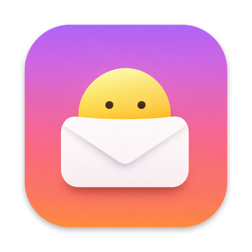
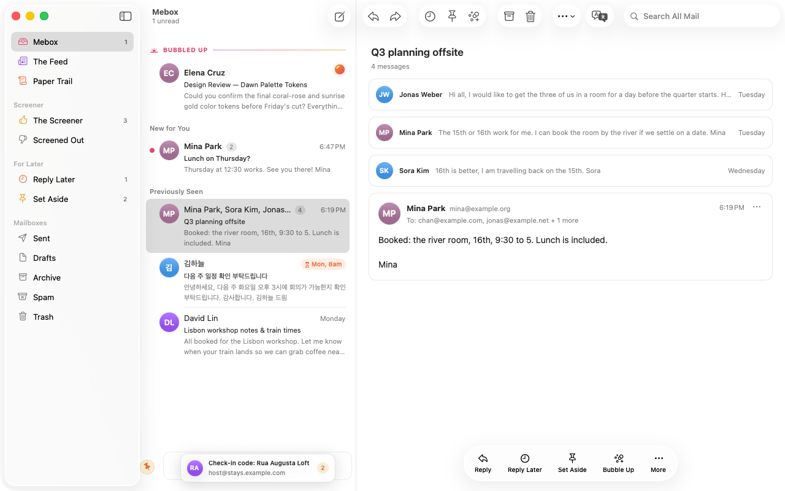
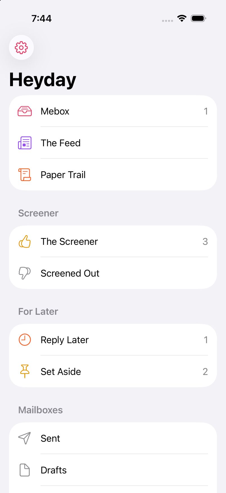
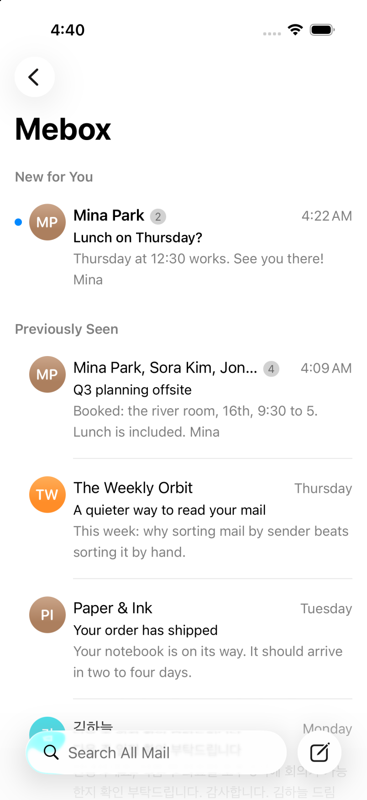
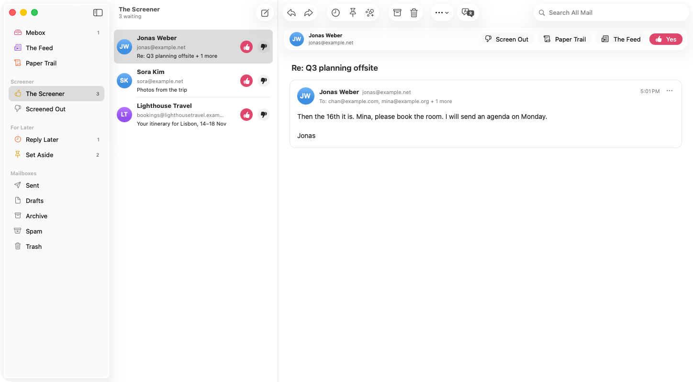
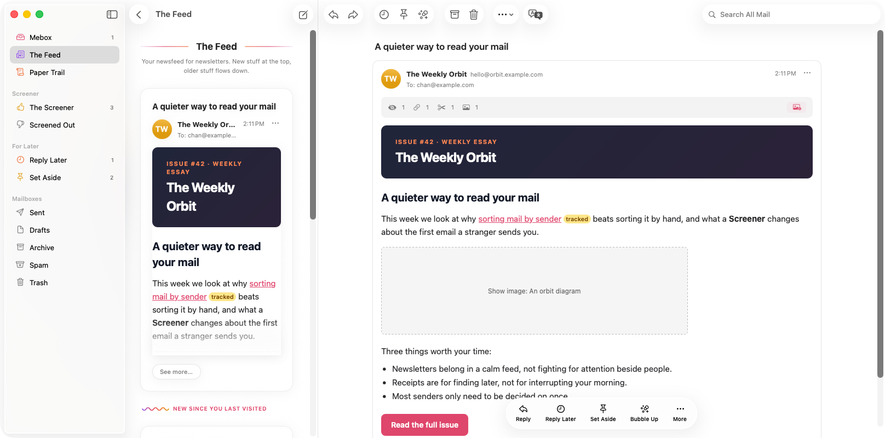

<p align="center">
  
</p>

<h1 align="center">Heyday</h1>

<p align="center">
  A native SwiftUI mail client for <strong>Mac, iPhone, and iPad</strong> that brings
  <a href="https://www.hey.com">HEY</a>'s email workflow to plain <strong>IMAP &amp; SMTP</strong>.
</p>

<p align="center">
  <code>macOS 15+</code> &nbsp;·&nbsp;
  <code>iOS 18+</code> &nbsp;·&nbsp;
  <code>iPadOS 18+</code> &nbsp;·&nbsp;
  <code>Pure SwiftUI</code> &nbsp;·&nbsp;
  <code>Zero Dependencies</code> &nbsp;·&nbsp;
  <a href="LICENSE"><code>MIT License</code></a>
</p>

<p align="center">
  <em>Personal open-source project. Not made or endorsed by 37signals.</em>
</p>

<p align="center">
  
</p>

Point Heyday at any IMAP/SMTP account — iCloud, Gmail, Fastmail, or a self-hosted server. On the Mac it also includes a one-click preset for **Proton Mail Bridge**.

---

## Highlights

- **The Screener** — Every first-time sender waits for a single yes/no before reaching your mail.
- **Mebox, The Feed, Paper Trail** — People, newsletters, and receipts separated cleanly without moving mail on the server.
- **Built-in Tracking Protection** — Strips tracking pixels and UTM/click-tracker parameters, flags opaque click-tracking links, and holds back per-recipient images by default.
- **Inline Translation** — Paragraph-by-paragraph translation right inside a conversation via Google Translate, DeepL, OpenAI, Claude, Gemini, OpenRouter, or any OpenAI-compatible local model.
- **Multi-Device Sync over IMAP** — Syncs Screener decisions, notification choices, and folder assignments across devices using your mail account itself.
- **Native on Mac, iPhone, and iPad** — Built from system controls and SF Symbols with zero third-party packages.

---

## Install

### macOS (DMG)

Download the latest Universal `.dmg` (`Apple Silicon` + `Intel`, macOS 15+) from [GitHub Releases](https://github.com/9j/heyday/releases/latest), open it, and drag **Heyday** into **Applications**.

Because the release build is signed ad hoc (not Apple-notarized), macOS Gatekeeper blocks downloaded copies on first launch ("app is damaged"). Clear the quarantine attribute once in Terminal, then open Heyday normally:

```sh
xattr -cr /Applications/Heyday.app
```

### Build from source

Requires Xcode 27 and [XcodeGen](https://github.com/yonaskolb/XcodeGen).

```sh
xcodegen generate
open Heyday.xcodeproj   # then Run

# Package a Universal macOS DMG locally:
Tools/make-dmg.sh
```

The first launch asks for your account: address, password, and the IMAP and SMTP
servers. For Proton Mail, click **"Use Proton Mail Bridge Settings"** and copy the
username and password from Bridge's Mailbox details. The password goes in your keychain.

The build is signed ad hoc, so every rebuild is a different app as far as the keychain
is concerned: after one, macOS asks again whether Heyday may read the password, and the
window says "Connecting" until you answer.

### iPhone and iPad

The same project has a second app, `Heyday-iOS`, built from the same sources.

```sh
# In a simulator: pick the Heyday-iOS scheme in Xcode, or
xcodebuild -project Heyday.xcodeproj -scheme Heyday-iOS \
  -destination 'platform=iOS Simulator,name=iPhone 17' -derivedDataPath build/DerivedData build

# On a device, signed by your team. `xcrun devicectl list devices` shows the identifier.
DEVELOPMENT_TEAM=<team id> xcodegen generate
xcodebuild -project Heyday.xcodeproj -scheme Heyday-iOS -configuration Release \
  -destination 'id=<device identifier>' -derivedDataPath build/DerivedData -allowProvisioningUpdates build
xcrun devicectl device install app --device <device identifier> \
  build/DerivedData/Build/Products/Release-iphoneos/Heyday.app
```

Proton Mail cannot be reached from a phone this way. Proton has no IMAP of its own:
Bridge provides it, Bridge runs on a computer, and it listens only to that computer.
Any other IMAP account (iCloud, Gmail, Fastmail and the like) works from the phone
directly.

<p align="center">
  
  &nbsp;&nbsp;&nbsp;&nbsp;
  
</p>

---

## How HEY's ideas map onto IMAP

IMAP has folders and flags, and nothing else. The rest is this app's doing:

| HEY | Here |
| --- | --- |
| The Screener | A decision per sender, kept on this Mac in `~/Library/Application Support/Heyday` and, for your other devices, in the account (see [The same on every device](#the-same-on-every-device)). An undecided sender's mail stays in your inbox on the server; the app holds it in the Screener until you say yes or no. |
| Imbox, The Feed, Paper Trail | **Mebox**, **The Feed**, and **Paper Trail** — three views of the server's inbox, split by where each sender is delivered. Nothing is moved on the server. **The Feed** renders newsletters as an open newsfeed of cards with inline *See more…* expansion; **Paper Trail** (and The Feed) mark mail read on the server automatically and draw a *New Since You Last Visited* divider using a synced visit watermark. |
| Screened Out | A fourth view of the inbox: mail from senders you said no to. Like The Feed and Paper Trail, it is marked read on the server when assigned and as more arrives, so other mail programs do not count it as new; Undo makes what your answer marked read unread again. |
| Reply Later, Set Aside | Real mailboxes on the server, so other mail clients see them too. The app makes a folder for each the first time you use it. |
| Seen and unseen | The IMAP `\Seen` flag. |
| Notifications | Off unless you ask, as in HEY: mail is announced only from a sender, or in a conversation, that you turned notifications on for. |

<p align="center">
  
</p>

The Screener only looks at mail that arrives after the account is added. Whatever the
server already held at that moment is let into Mebox without asking, going by when
the server received each message (`INTERNALDATE`), not by the date the sender wrote on
it. From then on, each sender is asked about once, the first time they write, whether
or not they wrote before. A decision covers everything the sender has sent, so
screening out the sender of an old email takes their old mail out of Mebox too.
Settings lists every decision and lets you change it.

Another mail program does not know the Screener's decisions: to it, all of this is
one inbox, in which The Feed, Paper Trail, and screened-out mail are already read. Heyday on another device does.

Mail arrives quietly. A conversation's menu (and the Message menu) has two switches:
Notify Me About This Conversation, and Notify Me When its sender Writes. New mail is
announced only when one of them is on for it, and only once it has been delivered to
one of the boxes: mail waiting in the Screener, or screened out, announces nothing.
Settings → Notifications lists the senders that are on. The count on the app's icon is
the unread count of Mebox, whatever is announced.

A server can refuse to make the Reply Later or Set Aside folder: Proton will not make a
folder that shares its name with a label. The app then asks which mailbox to use
instead, an existing folder or label or a new folder under another name, and moves the
waiting mail once you answer. Settings changes the choice later. Where the mailbox is a
label, mail put there is still in the inbox on the server, so the app keeps it out of
Mebox, The Feed and the Paper Trail itself.

---

## Tracking

An email's HTML is shown with scripts off and a policy that lets the page fetch
nothing from the network. Whatever is fetched, the app fetches, with no cookies,
referrer or stored credentials. Before the email is shown it is rewritten:

- An image that exists to report the email was opened is removed: one at an address a
  known mailing service uses for that, or any remote image one pixel in size.
- Tracking parameters such as `utm_source` and `mc_eid` are taken off the address of
  every other image.
- An image whose address then looks the same for every recipient is fetched as the
  email is shown.
- An image whose address could be a mark for you stays a placeholder until you click
  it or Load Images. That is one with a parameter that is not about how to serve the
  picture, or a host mailing services serve from.
- A link wrapped in a redirect that shows its destination (Google, Outlook Safe Links,
  Amazon SES and the like) is pointed straight at the destination, and tracking
  parameters such as `utm_source` are taken off.
- A link only its click tracker can resolve is left alone and marked `tracked`, and
  the app asks before opening one.

<p align="center">
  
</p>

A row of counts over the email says what was found: pixels blocked, links left
tracked, links cleaned, images held back. Clicking it spells them out. A reply or
forward quotes the original without its tracking pixels.

The app says little in words. What a count and a symbol can show is not written out,
empty lists do not explain themselves, and Settings keeps to the one line a person
could not work out alone, such as where a translation sends their mail.

Load as Sent, behind those counts and in a message's own menu, shows one email exactly as
it arrived instead: the page fetches the sender's pictures, style sheets and fonts
itself, tracking pixels included, and links open as written without asking. It is
there for the email that does not read right otherwise, and it asks first when a known
tracker would report. Scripts stay off, only encrypted addresses are fetched, and the
choice lasts until the conversation is closed; Protect Again undoes it sooner, though
not what the sender has already been told.

What this cannot do: whether an address is shared is judged from its look, and a
sender who wants to can make a personal address look plain, or write to you alone.
Any image that is fetched shows its server your network address and the time. Hiding
those takes a relay between you and the sender, which HEY and Apple run and this app
does not.

---

## The same on every device

IMAP has no place for what this app adds: who the Screener lets in, what to notify you
about, and which mailboxes hold Reply Later and Set Aside. So the app keeps them in
the account itself, as the JSON attachment of one message in a folder named `Heyday`
(`Folders/Heyday` on Proton). Heyday on another device signed in to the same account
reads that message and shows the same boxes.

- Each device reads the account when it starts, when it comes to the front, every five
  minutes, and whenever something changes here. It merges what it finds with its own
  and writes the result back only if the account lacks any of it.
- Nothing is lost when two devices change things apart: every decision is kept, and where
  they differ about a sender or a folder, the later choice stands. Screening starts
  from when the first device was set up.
- A message cannot be edited, so a change adds a new copy and removes the earlier one
  through the trash. On Proton and Gmail, removing it from the folder alone would
  leave it under All Mail.
- The message is hidden in this app. In another mail program it is one message,
  "Heyday data (state)", which says what it is. Deleting it does no harm: every device
  keeps its own copy and writes it again.

Settings → Account shows when the two were last in line, with a Sync Now button. Each
round trip is logged (`/usr/bin/log show --info --predicate 'subsystem == "app.heyday.mac"'`).
Translation settings and keys are per device and are not synced.

---

## Translation

Translate (`⇧⌘T`, the button over a conversation, or a message's own menu) puts the open
messages into your language, paragraph by paragraph, under each original or in its
place. Links, emphasis and inline code keep their place in the translation; code blocks,
bare addresses and text already in your language are left alone. Show Original switches
back without translating again. The language named over a translated message is a menu:
choosing another translates that message again, and is the language used from then on.

Settings → Translation chooses the language, the service and which of the two ways to
show it:

- **Google Translate** is the default and needs no key. It is reached through the
  address Google's own web pages use, which Google may limit or change.
- **DeepL** uses your DeepL API key.
- **OpenAI, Claude, Gemini, OpenRouter**, or any address that speaks OpenAI's protocol
  (a model on this Mac included), use your own key and a model you can name.

Nothing is sent until you choose Translate; then the text of the open messages goes
from this device straight to the service. Keys are kept in the keychain. The services and
their starting models are listed in
[`TranslationService.swift`](Sources/HeydayKit/Translation/TranslationService.swift).

---

## The window

Three columns on Mac and iPad, as in Mail: the lists in a sidebar, the chosen list's
conversations, and the open conversation. Under Heyday's boxes the sidebar shows the
account's own mailboxes and folders as the server names them. Each draft is its own
window. The Message and Go menus hold every action, with Mail's shortcuts where Mail
has one.

A row can be dealt with without opening it. Swiping it one way archives it or sends it
to the Trash; the other way marks it seen or unseen, or puts it in Reply Later or Set
Aside. On a Mac the same actions also appear on the row under the pointer. Whatever
moves mail, or answers the Screener about a sender, leaves a notice at the bottom of the
window for a few seconds with Undo; the Edit menu's Undo takes the same action back
after the notice has gone. Undo finds the mail again by its Message-ID, so it is not
offered for the odd message that has none.

A conversation opens on its newest email with the earlier ones folded to a line each,
and a long run of folded ones shows its first and last with a count between. A click on
an attachment looks at it; on a Mac it can also be dragged out, or saved to Downloads
from its menu. An email that sets no colours of its own is drawn in the app's, light or
dark; one that does keeps its white page. Animations are few and all of one family, and
become plain fades when Reduce Motion is on.

On iPhone the three columns become three screens, one leading to the next. On both
iPhone and iPad:

- a draft and the settings are sheets, not windows;
- the actions on an open conversation run along the bottom of the screen, and a new
  email starts beside the search field;
- pulling a list down asks the server for new mail (on a Mac: File › Get New Mail);
- an attachment opens in a preview, which is where it can be saved or shared;
- an email laid out wider than the screen is shrunk to fit, with its text kept readable.

New mail shows up while the app is open. iOS does not let an app listen to a mail
server from the background, so nothing arrives, and nothing is announced, while the
app is closed.

---

## Layout

| Path | What lives there |
| --- | --- |
| `Sources/HeydayKit` | Everything that is not a view: the IMAP and SMTP clients, the MIME parser, the Screener's rules, the tracker rules, the translators, syncing between devices, and one state machine per screen. No SwiftUI, no dependencies. |
| `Tests/HeydayKitTests` | Unit tests for HeydayKit, with the servers played back from scripts. |
| `App` | The SwiftUI app for all three platforms, built from system controls and SF Symbols: `Features` holds one folder per part of the window, `Components` the views and motions they share, `Platform` what the Mac and iPhone do differently (how a draft is presented, colours, the clipboard). Smaller differences are marked where they occur with `#if os(macOS)`. |
| `Tools/make-icon.swift` | Makes the app icons in `App/Resources/Assets.xcassets` from the artwork beside it, `Tools/icon-artwork.png`. |
| `docs` | Screenshots used in this README. |
| `project.yml` | The XcodeGen spec, with one app for the Mac and one for iPhone and iPad. `Heyday.xcodeproj` is generated and not checked in. |

Each screen is a `Feature` (`Sources/HeydayKit/Store/Store.swift`): a pure
`reduce(state, event)` that returns the effects to run, and an effect runner that talks
to the mail server and reports back with more events.

## Test

```sh
swift test
```

`LocalBridgeTests` also checks the real connection path against a Proton Mail Bridge on
this Mac, using a login that cannot exist. See the note in that file before running it
more than once or twice in a row.

## Not built yet

Bubble Up, saved drafts (closing a composer window discards what is in it, after
asking), labels beyond showing them as folders, attachments in the composer, rich-text
composing, more than one account, and showing your own sent replies inside a thread.
There is no setting to hold every image back, or to load all of a trusted sender's
without asking: Load as Sent is chosen one email at a time. Translation is asked for
each time: nothing is translated as it arrives, and a translation is not kept once its
conversation is closed.

## License

The source code is licensed under the [MIT License](LICENSE). The Heyday name and app
icon are not covered by the MIT license.
